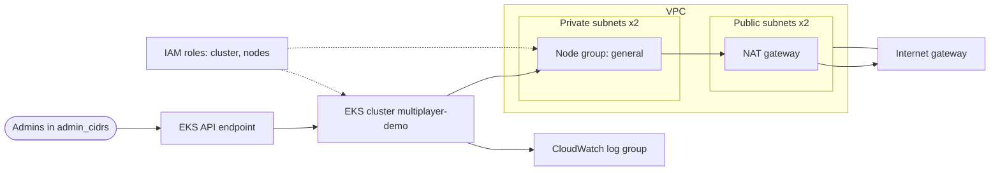

# Purpose
Runs the multiplayer demo on AWS: an EKS cluster named `multiplayer-demo` with a managed `general` node group, for Agones game servers and Open Match. It calls the [`modules/aws/eks`](../../modules/aws/eks/) child module.

# Cloud Provider Details
AWS Account: 123456789012
AWS Region: us-east-1
AWS VPC: Created by this configuration (`module.eks.vpc_id`)

# Diagram

# Most Recent Changes

10/20/2026 - Added environment docs (#25 - CouchParty Games)
