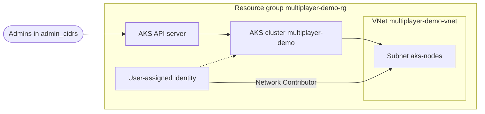

# Purpose
Runs the multiplayer demo on Azure: an AKS cluster named `multiplayer-demo` for Agones game servers and Open Match. It calls the [`modules/azure/aks`](../../modules/azure/aks/) child module.

# Cloud Provider Details
Azure Subscription: 00000000-0000-0000-0000-000000000000
Azure Region: eastus
Azure VNet: multiplayer-demo-vnet (created by this configuration in resource group `multiplayer-demo-rg`)

# Diagram

# Most Recent Changes

10/20/2026 - Added environment docs (#TBD - CouchParty Games)
