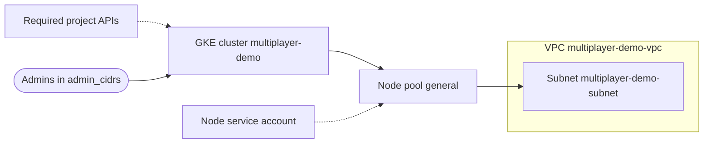

# Purpose
Runs the multiplayer demo on GCP: a GKE cluster named `multiplayer-demo` in zone `us-east1-b` with a `general` node pool, for Agones game servers and Open Match. It calls the [`modules/gcp/gke`](../../modules/gcp/gke/) child module.

# Cloud Provider Details
GCP Project: multiplayer-demo
GCP Region: us-east1
GCP VPC: multiplayer-demo-vpc (created by this configuration)

# Diagram

# Most Recent Changes

10/20/2026 - Added environment docs (#25 - CouchParty Games)
